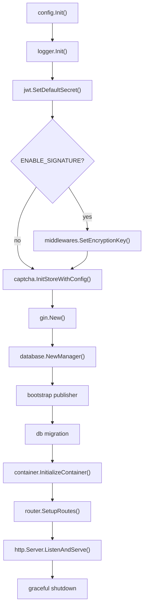
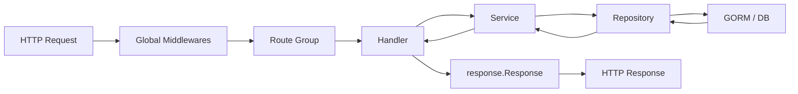
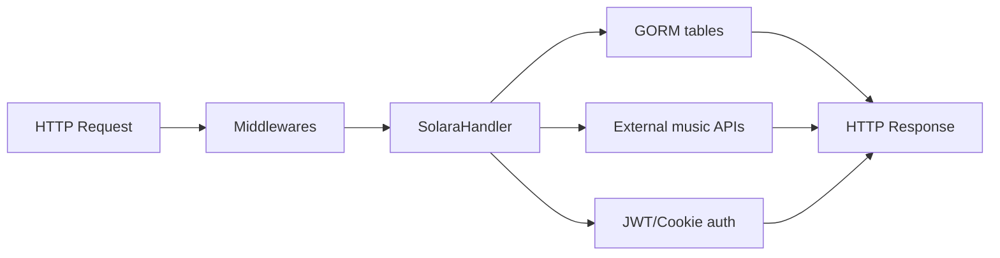

# Solara Backend Architecture

这份文档面向两个目标读者：

- 正在接手本仓库后端的新成员，需要快速理解系统怎么启动、怎么处理请求、模块之间怎么协作。
- 想以本项目为蓝本搭一个新 Go 后端项目的人，需要知道哪些设计值得继承，哪些实现只是当前项目的折中方案。

## 1. 架构定位

当前后端最准确的描述是：

- 分层单体应用
- Gin 作为 HTTP 入口
- 手动依赖注入，而不是代码生成式 DI
- GORM 作为主要持久化访问方式
- 通过接口抽象一小部分基础设施能力，例如 `EventPublisher`、`TaskRepository`
- 同时存在“标准分层路径”和“项目特化直连路径”

标准路径是：

`routes -> handlers -> services -> repositories -> database`

项目特化路径主要体现在 `SolaraHandler`：

- 直接依赖 `*gorm.DB`
- 直接访问外部 HTTP 音乐源
- 直接处理 Cookie/JWT 混合认证

所以，这个项目更像“有清晰分层骨架的工程化 Gin 单体”，而不是严格的 Clean Architecture / Hexagonal Architecture。

## 2. 总体模块划分

```text
backend/
├── cmd/server            # 进程启动入口与生命周期管理
├── internal/config       # 环境变量配置加载
├── internal/container    # 手动依赖注入与装配
├── internal/database     # 数据库抽象、连接与迁移
├── internal/routes       # 路由注册与中间件挂载
├── internal/handlers     # HTTP 适配层
├── internal/services     # 业务服务层
├── internal/repositories # 数据访问抽象与实现
├── internal/models       # GORM 模型
├── internal/dto          # 请求/响应 DTO
├── internal/middlewares  # 认证、安全、观测等横切逻辑
├── internal/messaging    # 事件发布、异步重试、Outbox
└── pkg                   # 可复用工具包与通用能力
```

## 3. 启动流程

后端的启动链路集中在 `backend/cmd/server/main.go`，核心顺序如下：



这个流程里有几个关键点：

- 配置、日志、JWT、验证码存储都带有全局状态。
- Kafka 发布器不是必需依赖，启动失败会回退到 `NoopPublisher`。
- 如果 Kafka 可用，会继续叠加 `AsyncPublisher`；如果数据库也可用，再叠加 `OutboxPublisher`。
- 容器负责最终组装 `repositories / services / handlers / router`。

## 4. 请求处理链路

大部分 API 请求都会走下面这条标准路径：



横切能力主要放在中间件里，例如：

- `RequestID` / `TraceID`
- `Metrics`
- `Logger`
- `Recovery`
- `CORS`
- `Security`
- `RateLimit`
- 条件启用的 `IPAccess` / `Signature` / `Encryption`

但并不是所有请求都遵循完整分层。`SolaraHandler` 这条链路更接近：



这说明当前项目里同时存在“可复制的通用后端骨架”和“为 Solara 产品快速交付而写的集成型处理器”。

## 5. 分层关系与依赖方向

### 5.1 标准分层

- `routes` 负责“把 URL 绑定到 handler，并决定挂哪些 middleware”。
- `handlers` 负责“HTTP 请求绑定、调用 service、格式化响应”。
- `services` 负责“业务规则、跨仓储协调、事件发布”。
- `repositories` 负责“具体的数据读取和写入”。
- `database` 负责“数据库连接、方言适配、迁移和连接池”。

### 5.2 横切模块

- `middlewares` 负责安全、观测和请求级控制。
- `messaging` 负责事件投递可靠性。
- `pkg/utils` 提供 JWT、加密、日志、验证码、响应封装等基础能力。

### 5.3 全局状态

以下能力使用了包级全局状态：

- `config.AppConfig`
- `pkg/utils/logger` 中的全局 logger
- `pkg/utils/jwt` 中配置后的默认 secret
- `pkg/utils/captcha` 中全局验证码存储
- `middlewares` 中的 IP 访问控制配置和指标收集器

这让接入非常方便，但也意味着：

- 初始化顺序要稳定
- 单元测试需要显式重置状态
- 如果未来拆多实例或做更强的依赖隔离，需要把这些全局状态改成显式注入

## 6. 基础设施能力

### 6.1 数据库

数据库抽象在 `internal/database` 中定义了 `Database` 接口，并提供：

- MySQL 实现
- PostgreSQL 实现
- MongoDB 实现

但从“整条业务链是否打通”来看，真正成熟的是 GORM 路线：

- `UserRepository`、`MenuRepository` 依赖 `*gorm.DB`
- `SolaraHandler` 也直接依赖 `*gorm.DB`
- 模型定义全部围绕 GORM

所以 MongoDB 目前更像“底层连接适配器已存在”，而不是“上层业务完整支持 Mongo 的一等实现”。

### 6.2 消息发布

事件系统通过 `EventPublisher` 抽象统一发布接口，再按启动条件逐层包裹：

- `NoopPublisher`: 完全禁用事件发布
- `KafkaPublisher`: 直接投递 Kafka
- `AsyncPublisher`: 非阻塞入队，后台 worker 重试
- `OutboxPublisher`: 先落库到 `event_outbox`，再轮询发送

这是本项目里最适合作为新项目参考的基础设施设计之一，因为它把“业务侧调用方式”与“可靠投递策略”解耦了。

### 6.3 安全与认证

系统支持三类安全控制：

- 身份认证：JWT
- 请求完整性：签名校验 `X-Signature` + `X-Timestamp`
- 边界控制：CORS、限流、IP 白黑名单、安全响应头

其中 JWT 是稳定可用的核心认证方式；签名和加解密是条件启用能力。

## 7. 适合作为新项目参考的设计

下面这些部分适合优先继承：

- 手动 DI + `container` 装配方式
- `handlers -> services -> repositories` 的主分层
- `EventPublisher` 抽象和 `Noop -> Async -> Outbox -> Kafka` 的演进式消息体系
- 统一 `response` 与 `apperr` 的错误输出约定
- `middlewares` 集中管理横切逻辑
- `health` 和 `metrics` 作为基础运维能力默认内建

如果你要搭一个新的 Go 后端项目，这几个点足以形成一个很稳的最小骨架。

## 8. 不建议直接照搬的部分

这份代码也有一些“能工作，但不适合作为模板原样复制”的地方：

- `SolaraHandler` 直接处理 DB、外部 API 和鉴权，跨越了多层边界。
- `ProvideTaskRepository` 只有在 MySQL 下才使用 DB 仓储，PostgreSQL 会退回内存仓储，策略不统一。
- README 声称支持 MongoDB，但上层仓储和 handler 仍强依赖 GORM。
- 启动代码注释说“数据库失败时可降级运行”，但容器装配阶段仍默认使用 `manager.GetDB()`，这一点需要额外保护。
- `Compression()` 目前只是占位日志，并没有真正压缩响应。
- 加解密中间件虽然存在，但默认没有配置任何命中路径。

如果新项目要参考本仓库，应该继承“架构骨架”，而不是无差别复制所有具体实现。

## 9. 推荐给新项目的落地版本

如果以本项目为参考搭新后端，我建议保留下面这条主干：

1. `cmd/server` 负责进程装配与优雅关闭。
2. `internal/config` 提供强类型配置和集中校验。
3. `internal/container` 进行手动依赖注入。
4. `internal/routes` 只做路由和 middleware 编排。
5. `handlers` 保持薄，避免直接访问 DB 或外部 API。
6. `services` 承担业务规则和跨依赖协调。
7. `repositories` 只处理持久化细节。
8. `messaging` 继续采用统一接口 + 可降级发布链路。
9. `pkg/utils` 只保留真正通用且无明显业务耦合的工具。

## 10. 模块分析

下面把原来拆开的模块分析合并到一个文件里，便于后续只维护这一份文档。

### 10.1 `cmd/server`

职责：

- 进程启动入口
- 全局配置初始化
- 日志、JWT、验证码存储、可选加密初始化
- 数据库与消息发布链路装配
- HTTP Server 启动与优雅关闭

可复用点：

- 单入口完成 bootstrap，排查启动问题很直接
- 通过 `http.Server` + signal 做优雅关闭
- 通过 `Noop -> Async -> Outbox -> Kafka` 逐层增强事件能力

注意点：

- 注释里说数据库失败可以降级运行，但容器装配实际仍假设 `dbManager` 可用
- 启动入口混入了较多产品特化逻辑，做新项目时应继续抽成可选 bootstrap 模块

### 10.2 `internal/config`

职责：

- 从 `.env` 和环境变量加载配置
- 把配置收敛为 `Config` 结构体
- 通过 `AppConfig` 向全项目暴露

可复用点：

- 用强类型配置集中管理环境变量
- 用辅助函数处理字符串、布尔值、整数和 CSV 配置

注意点：

- `AppConfig` 是全局状态，测试和多实例隔离要小心
- `JWT_SECRET` 有强校验，但 `SIGNATURE_SECRET` 目前只是读取，没有同等级别的校验

### 10.3 `internal/container`

职责：

- 手动依赖注入
- 组装 `repositories -> services -> handlers -> router`
- 构造 `HealthService` 的依赖检查清单

可复用点：

- 手动 DI 对中小型 Go 服务非常合适，透明、无代码生成、调试友好
- `providers.go` 适合作为基础设施实现切换点

注意点：

- `ProvideTaskRepository()` 只在 MySQL 下用 DB 仓储，其余情况退回内存实现，策略过于隐蔽
- `SolaraHandler` 直接依赖 `*gorm.DB`，打破了 handler 只依赖 service 的统一分层

### 10.4 `internal/database`

职责：

- 定义数据库抽象接口
- 建立连接、配置连接池、执行迁移、提供健康检查

支持的适配器：

- MySQL
- PostgreSQL
- MongoDB

可复用点：

- 通过 `Database` 接口统一不同数据库实现
- 通过 `Manager` 把连接、迁移和健康检查收敛到同一个入口

注意点：

- 真正打通的是 GORM 路线，不是所有上层模块都真的支持 MongoDB
- 迁移模型列表当前写死在 `Manager.Migrate()` 里，项目再变大时应按业务域拆分

### 10.5 `internal/routes`

职责：

- 挂载全局中间件
- 注册路由组
- 为特定路由组追加鉴权中间件

当前全局中间件顺序大致是：

1. `RequestID`
2. `TraceID`
3. `Metrics`
4. `Logger`
5. `Recovery`
6. `CORS`
7. `Security`
8. `NoCache`
9. `ContentType`
10. `RateLimit`
11. 条件追加 `IPAccess`
12. `Compression`
13. 条件追加 `Decryption -> Signature -> Encryption`

可复用点：

- 路由和中间件编排集中在一个地方，阅读成本低
- 通过路由组追加 `AuthMiddleware`、`RoleBasedAuth` 是很自然的 Gin 实践

注意点：

- 当前路由文件里既有标准业务 API，也有 Solara 的代理和存储桥接接口，新项目应拆分成多个 route module
- 根路径重定向到前端开发地址是项目约定，不适合作为模板默认值

### 10.6 `internal/handlers`

职责：

- 绑定 HTTP 请求
- 调用 service
- 选择 HTTP 状态码
- 输出统一响应

标准 handler：

- `UserHandler`
- `TaskHandler`
- `HealthHandler`
- `CaptchaHandler`

特殊 handler：

- `SolaraHandler`

可复用点：

- 标准 handler 很薄，只承担 HTTP adapter 角色
- `handlers.Handlers` 聚合对象让路由 wiring 更清晰

注意点：

- `SolaraHandler` 直接访问 DB、外部 API，并自行处理认证，更像集成网关逻辑而不是纯 handler
- 标准 API 和 Solara 相关接口的响应风格并不完全统一

### 10.7 `internal/services`

职责：

- 承载业务规则
- 协调仓储、加密、消息发布等依赖
- 提供平台型健康检查逻辑

当前主要服务：

- `TaskService`
- `UserService`
- `HealthService`

可复用点：

- `UserService.Login()` 是完整业务编排的好样板：查用户、验密码、发 JWT、查菜单、发登录事件
- `HealthService` 把依赖检查抽象成 `Enabled + Check`，非常适合作为平台基础能力

注意点：

- `TaskService` 目前校验比较轻
- 部分基础设施依赖通过包级全局状态间接提供，service 的真实依赖并不完全显式

### 10.8 `internal/repositories`

职责：

- 定义数据访问接口
- 提供具体存储实现

当前主要仓储：

- `TaskRepository`
- `UserRepository`
- `MenuRepository`

可复用点：

- 用接口定义仓储边界，让 service 保持稳定
- 在 DB 实现中集中处理 `gorm.ErrRecordNotFound` 与查询细节，减少 service 重复逻辑

注意点：

- `TaskRepository` 同时有内存版和 DB 版，但选择策略不统一
- `SolaraHandler` 仍绕过仓储层，直接访问 `*gorm.DB`
- 当前仓储层没有显式事务边界

### 10.9 `internal/models`

职责：

- 定义 GORM 模型
- 作为迁移和持久化的核心结构

当前主要模型：

- `User`
- `Role`
- `Menu`
- `UserRole`
- `RoleMenu`
- `Task`
- `PlaybackStore`
- `FavoritesStore`

可复用点：

- 用户、角色、菜单、关联表的权限模型比较清楚
- UUID 主键和显式 `TableName()` 都比较稳

注意点：

- 当前模型是 ORM 模型，不是纯领域模型
- `PlaybackStore`、`FavoritesStore` 强业务特化，不适合直接当通用模板实体
- 不同模型的 ID 类型并不完全统一

### 10.10 `internal/dto`

职责：

- 定义请求/响应 DTO
- 提供模型到响应的转换函数

可复用点：

- request DTO、response DTO、model 分离很清晰
- `ToTaskResponse`、`ToUserResponse` 这类转换函数足够轻量，适合中小型项目

注意点：

- `LoginRequest` 强依赖验证码，但 `AppLogin` 又绕开了这个 DTO，说明登录场景还没有完全统一
- 如果后续需要接口版本化，DTO 目录和命名需要更细化

### 10.11 `internal/middlewares`

职责：

- 实现观测、安全、鉴权和边界控制等横切能力

主要能力：

- 请求标识：`RequestID`、`TraceID`
- 观测：`Metrics`、`Logger`
- 恢复：`Recovery`
- 边界控制：`CORS`、`Security`、`NoCache`、`ContentType`、`RateLimit`、`IPAccess`
- 认证：`AuthMiddleware`、`OptionalAuth`、`RoleBasedAuth`
- 签名与加密：`SignatureMiddleware`、`OptionalSignatureMiddleware`、`DecryptionMiddleware`、`EncryptionMiddleware`

可复用点：

- `TraceID + RequestID + Logger + Metrics` 这一组很适合作为新项目默认基线
- 把认证、安全和请求治理集中在中间件层，扩展性很好

注意点：

- `Compression()` 目前只是占位，并不真正压缩响应
- `ContentType()` 只接受精确的 `application/json`
- 加解密中间件默认没有任何命中路径
- `RoleBasedAuth()` 里有一部分与 `AuthMiddleware()` 重复的 JWT 校验逻辑

### 10.12 `internal/messaging`

职责：

- 提供统一事件发布接口
- 封装异步、重试、Outbox 和 Kafka 投递能力

主要层次：

- `NoopPublisher`
- `KafkaPublisher`
- `AsyncPublisher`
- `OutboxPublisher`

可复用点：

- `EventPublisher` 接口设计很稳
- 通过 wrapper 叠加能力，而不是把复杂性暴露给业务层，非常适合新项目沿用
- Outbox 模式的落地已经比较完整

注意点：

- Outbox 当前绑在 GORM 上，如果新项目不用 GORM 需要重写 `OutboxStore`
- 异步失败目前主要靠日志，对关键链路可继续补监控、死信或人工补偿能力

### 10.13 `pkg` 公共工具

职责：

- 提供基础错误、统一响应、日志、密码学、JWT 和验证码能力

主要子模块：

- `apperr`
- `utils/response`
- `utils/logger`
- `utils/crypto`
- `utils/jwt`
- `utils/captcha`

可复用点：

- `apperr + response` 很适合作为新项目统一错误输出基线
- `jwt` 模块边界清楚，已经包含 secret 校验和 token 生成/验证
- 验证码模块支持 Redis 不可用时回退内存存储，适合中小型项目

注意点：

- 多处使用全局状态，例如 logger、JWT secret、captcha store
- `logger` 基于标准库 `log`，简单但不是结构化日志
- Redis 验证码客户端是手写 RESP 协议实现，轻量但维护成本高

## 11. 如果只拿这一份文档做新项目参考

最值得优先复用的是：

1. `cmd/server` 的 bootstrap 思路
2. `container` 的手动依赖注入
3. `routes -> handlers -> services -> repositories` 的主分层
4. `middlewares` 的集中治理
5. `messaging` 的统一发布接口和 Outbox 模式

最需要谨慎评估的是：

1. `SolaraHandler` 这类跨层集成型 handler
2. 不统一的仓储选择策略
3. 依赖包级全局状态的基础工具
4. 部分“已经预留但还没真正打通”的能力，例如 Mongo 路线、真实压缩、接口级加密
